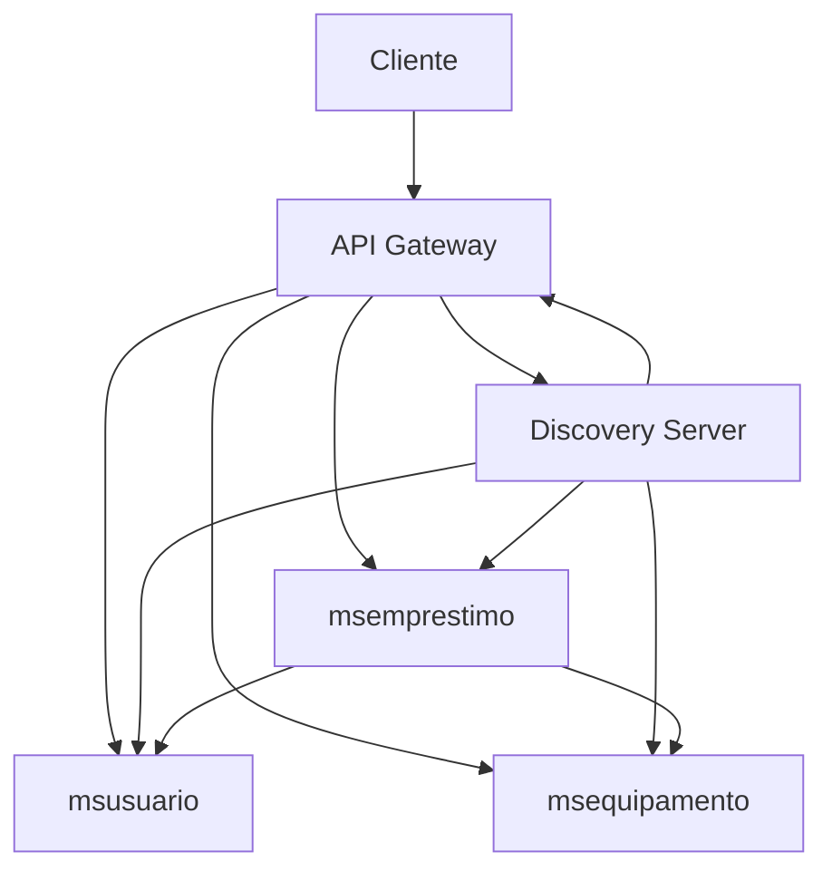

# Sistema de Empréstimo de Equipamentos - Microserviços

## Descrição
Sistema de empréstimo de equipamentos implementado com arquitetura de microsserviços usando Spring Boot, Spring Cloud e Eureka para descoberta de serviços.

## Arquitetura

O sistema é composto por 5 microsserviços:



## Serviços

### 1. Discovery Server (Eureka Server)
- **Porta**: 8761
- **Função**: Serviço de descoberta central onde todos os microsserviços se registram
- **Tecnologias**: Spring Boot, Netflix Eureka Server

### 2. API Gateway
- **Porta**: 8080
- **Função**: Ponto de entrada único para o sistema, roteia requisições para os serviços apropriados
- **Tecnologias**: Spring Cloud Gateway, Spring Cloud LoadBalancer, Eureka Client

### 3. msusuario (Microsserviço de Usuário)
- **Função**: Gerencia cadastro e consulta de usuários
- **Tecnologias**: Spring Boot, Spring Data JPA, PostgreSQL, Flyway, Eureka Client
- **Banco**: PostgreSQL (tb_usuarios)

### 4. msequipamento (Microsserviço de Equipamento)
- **Função**: Gerencia cadastro, disponibilidade e reservas de equipamentos
- **Tecnologias**: Spring Boot, Spring Data JPA, PostgreSQL, Flyway, Eureka Client
- **Banco**: PostgreSQL (tb_equipamentos)

### 5. msemprestimo (Microsserviço de Empréstimo)
- **Porta**: 8083
- **Função**: Coordena operações de empréstimo, comunicando-se com msusuario e msequipamento via OpenFeign
- **Tecnologias**: Spring Boot, Spring Data JPA, PostgreSQL, Flyway, OpenFeign, Eureka Client
- **Banco**: PostgreSQL (tb_emprestimos)

## Tecnologias Principais

- **Java 17**
- **Spring Boot 3.5.6**
- **Spring Cloud 2025.0.0**
- **Spring Cloud Netflix Eureka**
- **Spring Cloud Gateway**
- **Spring Cloud OpenFeign**
- **Spring Cloud LoadBalancer**
- **PostgreSQL**
- **Flyway** (migrações de banco de dados)
- **Lombok**
- **Maven**

## Pré-requisitos

- JDK 17 ou superior
- Maven 3.9+
- PostgreSQL 12+
- Git

## Como Executar

### Ordem de Inicialização

1. **Discovery Server** (Eureka)
   ```bash
   cd discovery-server
   mvn spring-boot:run
   ```

2. **msusuario**
   ```bash
   cd msusuario
   mvn spring-boot:run
   ```

3. **msequipamento**
   ```bash
   cd msequipamento
   mvn spring-boot:run
   ```

4. **msemprestimo**
   ```bash
   cd msemprestimo
   mvn spring-boot:run
   ```

5. **API Gateway**
   ```bash
   cd apigateway
   mvn spring-boot:run
   ```

### Verificação

Após iniciar todos os serviços:
- Acesse o Eureka Dashboard: http://localhost:8761
- Todos os serviços devem aparecer como "UP" no dashboard

## Configuração de Banco de Dados

Crie os bancos de dados no PostgreSQL:

```sql
CREATE DATABASE db_usuario;
CREATE DATABASE db_equipamento;
CREATE DATABASE db_emprestimo;
```

As tabelas são criadas automaticamente pelo Flyway na primeira execução de cada serviço.

## Endpoints Principais

Todos os endpoints são acessíveis através do API Gateway (porta 8080):

- **Usuários**: `/api/v1/usuarios/**`
- **Equipamentos**: `/api/v1/equipamentos/**`
- **Empréstimos**: `/api/v1/emprestimos/**`

## Estrutura do Projeto

```
Sistema de Emprestimo de Equipamentos/
├── apigateway/              # API Gateway
├── discovery-server/         # Eureka Server
├── msemprestimo/            # Microsserviço de Empréstimo
├── msequipamento/           # Microsserviço de Equipamento
└── msusuario/               # Microsserviço de Usuário
```

## Comunicação Entre Serviços

O serviço `msemprestimo` se comunica com `msusuario` e `msequipamento` usando:
- **OpenFeign**: Clientes HTTP declarativos
- **Eureka**: Descoberta dinâmica de serviços (sem URLs fixas)
- **LoadBalancer**: Distribuição de carga entre instâncias

## Fluxo de Empréstimo

1. Cliente solicita empréstimo via API Gateway
2. Gateway roteia para msemprestimo
3. msemprestimo valida usuário no msusuario
4. msemprestimo verifica disponibilidade no msequipamento
5. msemprestimo reserva equipamento no msequipamento
6. msemprestimo registra empréstimo no banco local
7. Resposta enviada ao cliente

## Desenvolvimento

Para compilar todos os serviços:
```bash
mvn clean install
```

Para rodar testes:
```bash
mvn test
```

## Autores

Sistema desenvolvido como estudo de caso de microsserviços com comunicação síncrona.

## Licença

Este projeto é para fins educacionais.
