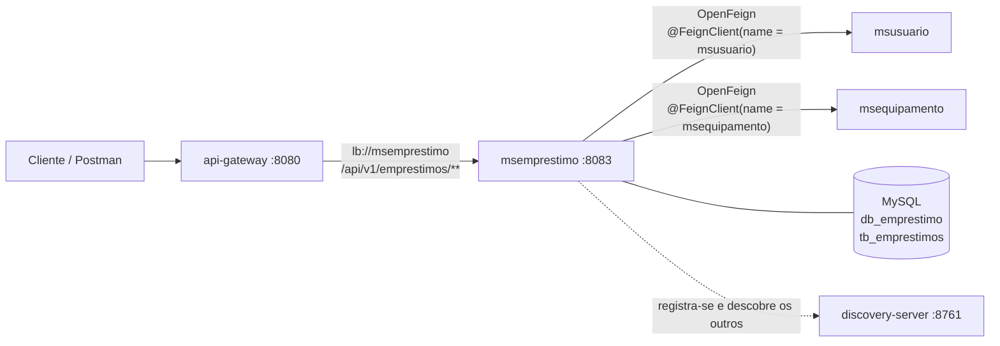
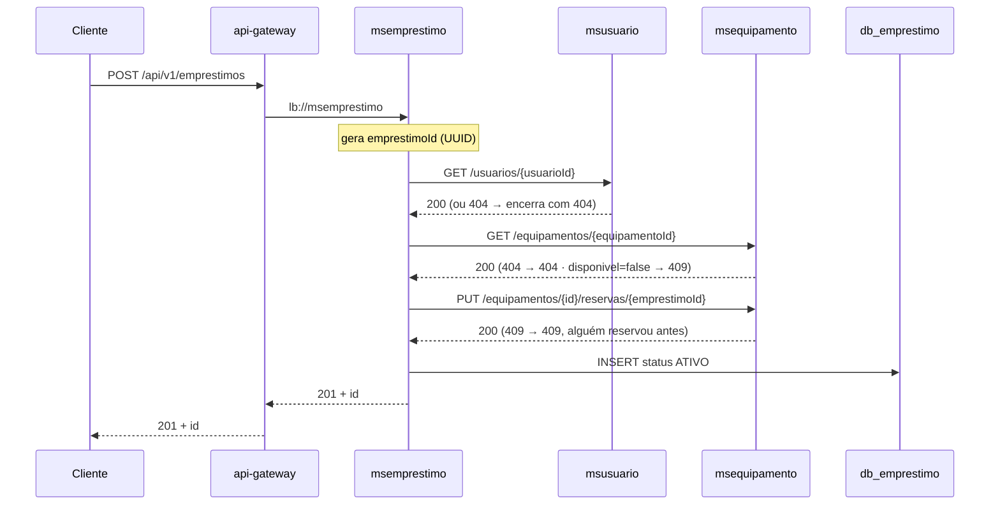

# msemprestimo

Microsserviço de **empréstimos** do Sistema de Empréstimo de Equipamentos (estudo de caso de microsserviços, etapa síncrona).

Ele **coordena** a operação: recebe a solicitação, confere o usuário no `msusuario`, reserva o equipamento no `msequipamento` e só então registra o empréstimo. Também registra a devolução e libera o equipamento. É o único dono da tabela `tb_emprestimos`.

**Stack:** Java 21 · Spring Boot 3.5.6 · Spring Cloud 2025.0.0 (BOM) · Spring Web · Spring Data JPA · MySQL · Flyway · Bean Validation · Eureka Discovery Client · **OpenFeign** · **Spring Cloud LoadBalancer** · Lombok · DevTools

---

## Onde ele se encaixa



| Item | Valor |
|---|---|
| Porta | **8083** |
| Nome no Eureka | `msemprestimo` (o mesmo usado na rota `lb://msemprestimo` da Gateway) |
| Banco | `db_emprestimo` (criado sozinho na primeira execução) |
| Tabela | `tb_emprestimos` (criada pelo Flyway: `V1__create_tb_emprestimos.sql`) |
| Depende de | `msusuario` e `msequipamento`, encontrados **pelo nome** no Eureka, sem URL fixa |

---

## Como executar

**Pré-requisitos:** JDK 21, Maven 3.9+ e MySQL 8 em `localhost:3306`.

```bash
mvn clean test          # testes unitários (não precisam de banco nem dos outros serviços)
mvn spring-boot:run     # sobe na porta 8083
```

**Ordem de subida do sistema completo:** `discovery-server` → `msusuario` → `msequipamento` → `msemprestimo` → `api-gateway`. Em http://localhost:8761 os quatro clientes devem aparecer como `UP`. O registro leva até ~30 s; antes disso, a Gateway e o Feign respondem `503`.

| Variável | Padrão | Uso |
|---|---|---|
| `DB_HOST` / `DB_USER` / `DB_PASSWORD` | `localhost` / `root` / `root` | MySQL |
| `EUREKA_URL` | `http://localhost:8761/eureka` | discovery-server |

> Ao contrário dos outros dois serviços, o `msemprestimo` não funciona sem Eureka: é pelo Eureka que o Feign encontra o `msusuario` e o `msequipamento`.

---

## O que este serviço espera dos colegas

O `msemprestimo` depende só do contrato do enunciado. Vale conferir com quem fez os outros serviços:

| Serviço | Chamada | Respostas esperadas |
|---|---|---|
| `msusuario` | `GET /api/v1/usuarios/{id}` | `200` com `{ id, nome, email, matricula }` · **`404` se não existir** |
| `msequipamento` | `GET /api/v1/equipamentos/{id}` | `200` com `{ id, ..., disponivel }` · `404` |
| `msequipamento` | `PUT /api/v1/equipamentos/{id}/reservas/{emprestimoId}` | `200` reservado (inclusive na repetição) · `404` · **`409` ocupado** |
| `msequipamento` | `DELETE /api/v1/equipamentos/{id}/reservas/{emprestimoId}` | `204`, **inclusive se já liberado** · `404` |

Os três pontos em negrito são os que mais quebram a integração. Se o `msusuario` devolver `500` em vez de `404`, ou se a liberação repetida der erro, o `msemprestimo` vai responder `503`.

---

## Endpoints

| Método e rota | Sucesso | Erros |
|---|---|---|
| `POST /api/v1/emprestimos` | `201` + `Location` | `400` · `404` usuário/equipamento · `409` ocupado · `503` |
| `GET /api/v1/emprestimos/{id}` | `200` | `400` UUID inválido · `404` |
| `GET /api/v1/emprestimos/usuarios/{usuarioId}` | `200` (mais recentes primeiro; vazio se não houver) | `400` |
| `PATCH /api/v1/emprestimos/{id}/devolucao` | `200` com status `DEVOLVIDO` | `404` · `409` já devolvido/cancelado · `503` |
| `PATCH /api/v1/emprestimos/{id}/cancelamento` *(extra)* | `200` com status `CANCELADO` | `404` · `409` · `503` |

O cancelamento não está no contrato mínimo. Foi incluído para que o status `CANCELADO` do enum tenha uso.

Os erros seguem **Problem Details (RFC 9457)**:

```json
{
  "type": "about:blank",
  "title": "Conflito",
  "status": 409,
  "detail": "Equipamento PAT-0001 está indisponível",
  "instance": "/api/v1/emprestimos"
}
```

### Exemplos

**Solicitar**

```http
POST http://localhost:8080/api/v1/emprestimos
Content-Type: application/json

{
  "usuarioId": "11111111-1111-1111-1111-111111111111",
  "equipamentoId": "22222222-2222-2222-2222-222222222222"
}
```

```http
HTTP/1.1 201 Created
Location: http://localhost:8083/api/v1/emprestimos/33333333-3333-3333-3333-333333333333

{
  "id": "33333333-3333-3333-3333-333333333333",
  "usuarioId": "11111111-1111-1111-1111-111111111111",
  "equipamentoId": "22222222-2222-2222-2222-222222222222",
  "dataEmprestimo": "2026-11-10T10:00:00.123",
  "dataDevolucao": null,
  "status": "ATIVO"
}
```

**Devolver**

```http
PATCH http://localhost:8080/api/v1/emprestimos/33333333-3333-3333-3333-333333333333/devolucao
```

```http
HTTP/1.1 200 OK

{ "id": "3333...", "status": "DEVOLVIDO", "dataDevolucao": "2026-11-12T16:30:00.456", ... }
```

---

## Fluxo da solicitação (item 7 do enunciado)



Em `EmprestimoService.solicitar`, cada passo está comentado com o número correspondente do enunciado.

**Por que o ID é gerado antes de tudo?** A reserva no `msequipamento` é idempotente pela chave `emprestimoId`. O empréstimo precisa ter ID *antes* de existir no banco, para que a reserva, uma eventual repetição e a liberação usem sempre a mesma chave.

**Por que consultar e depois reservar?** A consulta permite responder `404`/`409` com mensagem clara antes de tentar reservar. Quem decide de fato é a reserva atômica: se outro empréstimo reservar entre a consulta e a reserva, o `msequipamento` responde `409`.

---

## Devolução sem liberar duas vezes

```
PATCH /{id}/devolucao
  ├─ empréstimo não existe ............. 404
  ├─ já DEVOLVIDO ou CANCELADO ......... 409, sem chamar o msequipamento
  └─ ATIVO
       ├─ DELETE .../reservas/{id} ..... falhou? → 503, continua ATIVO (pode repetir)
       └─ grava DEVOLVIDO + data ....... 200
```

- **Recusa antes de chamar:** um empréstimo que já não está ATIVO nunca dispara uma nova liberação.
- **Libera primeiro, grava depois:** se a liberação falhar, nada muda e a devolução pode ser repetida. Se a liberação der certo e a gravação falhar, repetir também é seguro, porque o `DELETE` é idempotente.
- **Duas devoluções ao mesmo tempo:** o campo `@Version` (controle otimista) deixa só a primeira gravar; a segunda recebe `409`.

---

## Limites de consistência entre bancos independentes

O enunciado pede para *explicar* esses limites, então esta seção serve de roteiro para a apresentação.

Um empréstimo altera **dois bancos** (`db_equipamento` e `db_emprestimo`), e não existe transação que abranja os dois. Por isso os métodos que chamam outros serviços **não** são `@Transactional`: uma transação aberta durante chamadas HTTP prenderia conexões e, mesmo assim, não desfaria nada no outro serviço.

O que foi feito para cada falha possível:

| Falha | O que acontece | Resultado |
|---|---|---|
| Usuário/equipamento não existe | Para antes de reservar | `404`, nada mudou |
| Equipamento ocupado | Para antes de gravar | `409`, nada mudou |
| Reserva deu timeout / `msequipamento` caiu | **Compensação:** tenta liberar com o mesmo `emprestimoId` (seguro mesmo se a reserva não tiver acontecido) | `503` |
| Reservou, mas falhou ao gravar no banco local | **Compensação:** libera a reserva | `409` ou `500` |
| Liberação falhou na devolução | Não grava DEVOLVIDO | `503`, repetir resolve |

**A brecha que sobra:** se a reserva acontecer e a compensação *também* falhar (o `msequipamento` caiu exatamente nesse intervalo), o equipamento fica reservado para um empréstimo que não existe. O serviço registra no log um erro `COMPENSAÇÃO FALHOU` já com o comando de correção (`DELETE .../reservas/{emprestimoId}`).

Comunicação síncrona não consegue fechar essa brecha sozinha. A solução está na próxima etapa da disciplina: **mensageria** (RabbitMQ/Kafka) com o padrão **Saga** e **Outbox**, em que a compensação vira uma mensagem persistida e reenviada até dar certo.

**Defesa extra no banco local:** a tabela tem uma coluna calculada `equipamento_ativo`, que só tem valor enquanto o status é `ATIVO`, com índice `UNIQUE`. O MySQL ignora `NULL` no `UNIQUE`, então o próprio banco garante **no máximo um empréstimo ATIVO por equipamento**, mesmo que algo escape do `msequipamento`.

---

## Estrutura

```
msemprestimo/
├── pom.xml
├── msemprestimo.postman_collection.json      # preparação + 18 cenários + 2 manuais
├── src/main/java/br/com/emprestimo/msemprestimo/
│   ├── MsEmprestimoApplication.java          # @EnableFeignClients
│   ├── controller/EmprestimoController.java  # rotas /api/v1/emprestimos
│   ├── service/EmprestimoService.java        # orquestração, compensação, tradução de erros
│   ├── client/UsuarioClient.java             # @FeignClient(name = "msusuario")
│   ├── client/EquipamentoClient.java         # @FeignClient(name = "msequipamento")
│   ├── client/dto/                           # "visão" dos dados dos outros serviços
│   ├── repository/EmprestimoRepository.java
│   ├── model/Emprestimo.java                 # só IDs externos, sem @ManyToOne
│   ├── model/StatusEmprestimo.java           # ATIVO, DEVOLVIDO, CANCELADO
│   ├── dto/                                  # EmprestimoRequest / EmprestimoResponse
│   ├── config/ClockConfig.java               # relógio injetável (testes com data fixa)
│   └── exception/                            # 404, 409, 503 e handler centralizado
├── src/main/resources/
│   ├── application.yml                       # timeouts do Feign + log das chamadas
│   └── db/migration/V1__create_tb_emprestimos.sql
└── src/test/java/.../service/EmprestimoServiceTest.java   # 13 testes unitários
```

Decisões que vale saber explicar:

- **Tradução de erros:** uma `FeignException.NotFound` vinda do `msusuario` vira `404 "Usuário ... não encontrado"`; uma `Conflict` do `msequipamento` vira `409`; qualquer outra falha (serviço fora, sem instância no Eureka, timeout) vira `503`. O cliente nunca vê o erro bruto de outro serviço.
- **Timeouts:** 2 s para conectar e 5 s para ler (`spring.cloud.openfeign.client.config.default`). Sem eles, um serviço travado prenderia a requisição.
- **Log das chamadas Feign:** com `logger-level: basic`, o console mostra cada chamada (método, URL, status e tempo). Isso ajuda a demonstrar o fluxo na apresentação.
- **Entidade sem setters:** o estado só muda por `devolver()` e `cancelar()`.

---

## Testes

**Unitários** (`mvn test`): os clientes Feign e o repositório são simulados com Mockito; as respostas 404/409/503 são `FeignException` reais. Cobrem:

- solicitação com sucesso (e a reserva usando o mesmo ID gravado);
- usuário inexistente, `msusuario` fora do ar, equipamento inexistente ou indisponível;
- corrida na reserva (`409`, sem liberar a reserva do outro);
- falha na reserva com compensação, e falha ao gravar com compensação;
- devolução, devolução repetida (sem nova liberação), devolução com `msequipamento` fora do ar (continua ATIVO);
- cancelamento.

**Postman:** importe `msemprestimo.postman_collection.json` e use *Run collection* com o sistema inteiro no ar.

| Pasta | Conteúdo |
|---|---|
| Preparação | Cria um usuário e um equipamento nos serviços dos colegas, com dados únicos a cada execução |
| Cenários (01–18) | Sucesso, reserva conferida no `msequipamento`, 409 ocupado, 404 usuário/equipamento, 400, consultas, devolução, devolução repetida (409), equipamento disponível de novo, novo empréstimo, cancelamento |
| Manual | `503` com `msequipamento` ou `msusuario` desligado. Rode cada requisição sozinha, ~30 s depois de desligar o serviço |

---

## Problemas comuns

| Sintoma | Causa provável |
|---|---|
| `503` em toda solicitação | `msusuario` ou `msequipamento` não registrado no Eureka. Veja o painel em :8761 e o nome em `spring.application.name` de cada um |
| `503` só logo após subir | Registro no Eureka ainda em andamento (~30 s) |
| `404` de usuário que existe | O `msusuario` está em outra rota (deve ser `/api/v1/usuarios/{id}`) |
| Aviso `Spring Cloud LoadBalancer is currently working with the default cache` | Inofensivo em desenvolvimento |
| `Validate failed: checksum mismatch` (Flyway) | A `V1` foi editada após executar. Em desenvolvimento: `DROP DATABASE db_emprestimo;` e suba de novo |
| Getters/builders "não existem" na IDE | Habilitar annotation processing (Lombok) |
